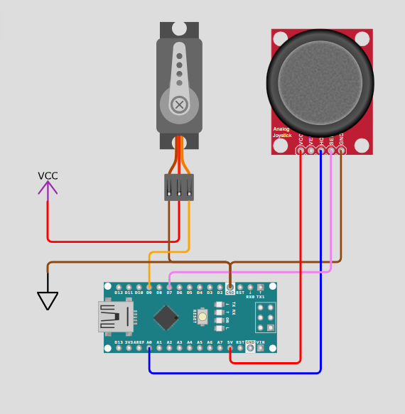

# ⚙️ 90° Servo Calibration Guide / Guía de Calibración de Servos a 90°

🌐 **Select Language / Selecciona el idioma:** [🇬🇧 English](#english-version) | [🇪🇸 Español](#versión-en-español)

---

## English Version

### 🎯 Why Calibrate Before Assembly?
Standard hobby servomotors (like the MG996R) have a limited physical rotation range of **0° to 180°** and do not return to a neutral position when powered off. 

If you screw the aluminum brackets (*servo horns*) onto the motor shaft at a random angle:
1. **Asymmetrical Range:** The joint will not be able to bend equally in both directions.
2. **Mechanical Collisions:** The arm links may hit the base or themselves before reaching the software target angle.
3. **Motor Burnout:** If the structure physically blocks the movement while the microcontroller continues commanding the servo to reach an unreachable angle, the motor will stall, drawing massive current that can melt the internal electronics or strip the gears.

By building a physical **Servo Positioner** with a joystick, we can test the smoothness of the internal gears across the full 180° range and lock the shaft at the exact **90° center point** before fastening any screws.

---

### 🔌 Wiring & Pinout (Arduino Nano)

> ⚠️ **Power Warning:** Never power the servomotor directly from the Arduino `5V` pin under load. Use an external 5V/6V power supply for the servo and connect all grounds (`GND`) together. Conversely, **always power the Joystick strictly at 5V** (from the Arduino); feeding 6V to the joystick shifts the analog voltage divider outside the Arduino's ADC range.

| Component | Pin | Connected To | Notes |
| :--- | :--- | :--- | :--- |
| **Power Supply** | `GND (-)` | Common GND (Breadboard) | Shared with Nano `GND` and Joystick `GND` |
| **Servomotor** | `VCC` (Red) | External Supply `+5V / +6V` | High current line |
| **Servomotor** | `GND` (Brown/Black) | Common GND | Reference ground |
| **Servomotor** | `Signal` (Orange/Yellow) | Arduino Nano `D9` | PWM control signal |
| **Joystick (KY-023)** | `+5V` | Arduino Nano `5V` | **Strictly 5V** for accurate ADC center (~512) |
| **Joystick (KY-023)** | `GND` | Common GND | Reference ground |
| **Joystick (KY-023)** | `VRx` | Arduino Nano `A0` | Analog X-axis reading (`0` to `1023`) |
| **Joystick (KY-023)** | `SW` | Arduino Nano `D7` | Center push-button (uses internal `INPUT_PULLUP`) |

#### Circuit Diagram
<!-- Sube tu imagen a docs/images/ y asegúrate de que el nombre coincida con el de abajo -->

  

---

### 🛠️ Step-by-Step Calibration Procedure

1. **Upload the Firmware:** Open [`tools/calibrador_joystick_nano/calibrador_joystick_nano.ino`](../tools/calibrador_joystick_nano/calibrador_joystick_nano.ino) in the Arduino IDE and upload it to the Arduino Nano.
2. **Gear & Sweep Test:** Connect the first servomotor. Gently tilt the joystick left and right to sweep the motor from `0°` to `180°`. Verify that the movement is smooth and free of clicking sounds.
3. **Lock at 90°:** Press the joystick button down (`SW`). The motor will immediately rotate to its `90°` electronic center and hold its torque.
4. **Fasten the Bracket:** **Keeping the power on** so the shaft cannot slip, place the metal servo horn or bracket onto the geared shaft aligned with the neutral mechanical position for that joint:
   * **Base & Wrist Rotation:** Facing straight forward.
   * **Shoulder, Elbow & Wrist Pitch:** Aligned straight vertically (or at the exact 90° square angle shown in the assembly manual).
   * **Gripper (Claw):** Half-open at `90°` (or move the joystick to the closed limit to align the fingers fully shut without stalling).
5. **Secure & Repeat:** Turn off the power, screw in the central M3 bolt to lock the horn, and repeat for the remaining 5 servos.

---

### 🔍 Troubleshooting (Common Issues)

* **Upload Error `not in sync: resp=0x50`:** Most Arduino Nano clones (CH340 driver) use the legacy bootloader. In Arduino IDE, go to `Tools > Processor` and select **"ATmega328P (Old Bootloader)"**.
* **Servo automatically returns to `0°` when releasing the joystick:** The Arduino is reading `< 400` at rest instead of `~512`. Check that the joystick `+5V` and `GND` wires are firmly connected and that you are powering the joystick from the Arduino's `5V` pin (not from a 6V external source).

---
---

## Versión en Español

### 🎯 ¿Por qué calibrar antes de montar?
Los servomotores estándar (como los MG996R) tienen un giro físico limitado de **0° a 180°** y no cuentan con ningún muelle que los devuelva al centro al apagarse.

Si atornillas los soportes de aluminio (*horns*) al eje del motor en una posición aleatoria:
1. **Rango asimétrico:** La articulación no podrá doblarse por igual hacia ambos lados.
2. **Colisiones mecánicas:** Los eslabones del brazo chocarán contra la base o contra sí mismos antes de alcanzar el ángulo que pide el código.
3. **Quemadura del motor:** Si el chasis bloquea físicamente el giro pero el microcontrolador sigue ordenando avanzar, el motor se queda atascado haciendo fuerza máxima, generando picos de corriente que queman la electrónica interna o rompen los engranajes.

Construyendo este **Posicionador de Servos** con un joystick, podemos comprobar la fluidez de los engranajes en todo su recorrido de 180° y dejar el eje bloqueado exactamente en su **punto medio de 90°** antes de poner los tornillos.

---

### 🔌 Conexiones y Pines (Arduino Nano)

> ⚠️ **Aviso de alimentación:** Nunca alimentes los servomotores bajo carga desde el pin `5V` del Arduino. Usa una fuente externa de 5V/6V para el motor y une todas las tierras (`GND`). Por el contrario, **alimenta el Joystick estrictamente a 5V** (desde el pin `5V` del Arduino); meterle 6V al joystick desplaza su divisor de tensión fuera de la escala del conversor analógico (ADC) del Nano.

| Componente | Pin | Conectado a | Notas |
| :--- | :--- | :--- | :--- |
| **Fuente Externa** | `GND (-)` | GND Común (Protoboard) | Unido al `GND` del Nano y al `GND` del Joystick |
| **Servomotor** | `VCC` (Rojo) | Fuente Externa `+5V / +6V` | Línea de potencia para el motor |
| **Servomotor** | `GND` (Marrón) | GND Común | Tierra de referencia |
| **Servomotor** | `Señal` (Naranja) | Arduino Nano `D9` | Señal de control PWM |
| **Joystick (KY-023)** | `+5V` | Arduino Nano `5V` | **Estrictamente 5V** para centrar la lectura en ~512 |
| **Joystick (KY-023)** | `GND` | GND Común | Tierra de referencia |
| **Joystick (KY-023)** | `VRx` | Arduino Nano `A0` | Lectura analógica del eje X (`0` a `1023`) |
| **Joystick (KY-023)** | `SW` | Arduino Nano `D7` | Botón central (usa resistencia interna `INPUT_PULLUP`) |

#### Esquema del Circuito

  

---

### 🛠️ Procedimiento de Calibración Paso a Paso

1. **Subir el código:** Abre [`tools/calibrador_joystick_nano/calibrador_joystick_nano.ino`](../tools/calibrador_joystick_nano/calibrador_joystick_nano.ino) en el IDE de Arduino y cárgalo en el Arduino Nano.
2. **Prueba de recorrido:** Conecta el primer servomotor. Inclina el joystick suavemente a izquierda y derecha para recorrer de `0°` a `180°` y verificar que los engranajes giran con suavidad.
3. **Bloquear a 90°:** Pulsa el botón central del joystick hacia adentro (`SW`). El motor girará automáticamente hasta su centro electrónico (`90°`) y se quedará haciendo fuerza para mantenerlo.
4. **Encajar el soporte:** **Manteniendo el circuito encendido** para que el eje no se mueva, encaja la cruceta o soporte metálico alineado en la posición neutral de esa articulación:
   * **Base y Rotación de Muñeca:** Mirando completamente hacia el frente.
   * **Hombro, Codo e Inclinación de Muñeca:** Alineados en vertical (o en el ángulo recto exacto que indique el vídeo de montaje).
   * **Pinza (Garra):** Medio abierta a `90°` (o llevando el motor al extremo con el joystick para encajar los dedos totalmente cerrados sin forzar).
5. **Atornillar y repetir:** Apaga la alimentación, coloca el tornillo central en el eje del servo y repite el proceso con los 5 motores restantes.

---

### 🔍 Solución de Problemas Frecuentes (Troubleshooting)

* **Error al subir el código `not in sync: resp=0x50`:** La mayoría de placas Arduino Nano utilizan el gestor de arranque antiguo. En el IDE de Arduino, ve a `Tools > Processor` y selecciona **"ATmega328P (Old Bootloader)"**.
* **El servo vuelve solo a `0°` al soltar el joystick:** El Arduino está leyendo un valor `< 400` en reposo en lugar de `~512`. Revisa que los cables `+5V` y `GND` del joystick no estén sueltos y asegúrate de alimentarlo a **5V** desde el Arduino (no a 6V).
